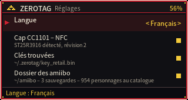
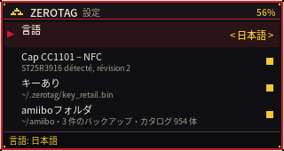

# ZeroTag

An amiibo library and emulator for the [M5Stack CardputerZero](https://docs.m5stack.com/) with the
**Cap CC1101** (ST25R3916 NFC front end). Browse your backups, create blank signed amiibo, emulate them
on a console, and keep what the game writes back.

 

## Features

- **Library** of 540-byte NTAG215 backups (`~/amiibo/*.bin`): characters are recognised automatically from the
  image, with the signature checked when your keys are present. Type to filter the list.
- **Catalogue** of 954 characters (metadata from [AmiiboAPI](https://www.amiiboapi.org)); create a blank,
  correctly signed amiibo with a random UID.
- **Emulation** of an NTAG215 over NFC-A (ISO 14443-3A) with live counters. Verified with a Flipper Zero and with
  a Nintendo Switch 2, a 3DS and a Wii U: the console reads the figure, and registering an owner works.
- **Scan** of your real figures (`F4` in the library): put the amiibo on the Cap, it is read and saved to your folder.
- **Writes are kept**: what a console writes is saved to the file, automatically a moment after the last write
  and again when you stop. Signatures stay valid.
- **UID rotation** (optional): after each read the amiibo gets a new UID, re-signed with your keys, so a game
  sees a "different" figure every time. Data is kept.
- **Search** in both lists: several words, accents and case ignored, names, series and the 16-digit id.
- **Online update** (optional, off by default): Settings > Online, then "Check for new amiibo" downloads the public
  [AmiiboAPI](https://www.amiiboapi.org) list with `curl` and shows figures missing from the bundled catalogue
  marked `NEW`, or `SOON` before their release date. Only that public list is requested; nothing about you or the
  device is sent. The answer is kept in `~/.zerotag/amiibo_online.json`; without the option the app never uses
  the network.
- Famicom-style interface in French, English, Japanese and Simplified Chinese, with in-app help (`Fn+H`) and a
  demoscene manual in the settings.

## What you need

- A CardputerZero with the **Cap CC1101** fitted (power the device off before changing a Cap).
- Your own `key_retail.bin` (160 bytes). It is **never** shipped or downloaded by ZeroTag. Without it you can still
  browse and emulate existing backups, but not create amiibo, rotate UIDs or check signatures.
- Amiibo backups you own, if you want more than blank figures.

## Install

Download the `.deb` from the [releases page](../../releases) and install it on the device:

```shell
sudo apt install ./ZeroTag_<version>_rev1_arm64.deb
```

The package adds ZeroTag to the APPLaunch menu. The application runs as your user (it needs the `spi` and `gpio`
groups, which the default user has) and installs no background service.

The Cap needs an SPI device-tree overlay, which only root can load and which is lost at every reboot. If it is
missing when ZeroTag starts (or when you try to emulate), ZeroTag offers to enable it: type your `sudo` password on
the device keyboard (just `Enter` if your account needs none). The password goes straight to `sudo`, is never stored
or logged, and is wiped from memory afterwards. You can also do it yourself, once after each boot:

```shell
sudo /usr/lib/zerotag/cap-setup
```

Then, as the device user:

```shell
mkdir -p ~/.zerotag ~/amiibo
cp key_retail.bin ~/.zerotag/key_retail.bin && chmod 600 ~/.zerotag/key_retail.bin
```

**Thumbnails**: the `.deb` includes a small picture of each amiibo (artwork owned by Nintendo, taken from the
AmiiboAPI image repository, for display only). They are not part of this source repository. If you build from source,
fetch them yourself with `tools/fetch_amiibo_images.py` (Python with Pillow) into `assets/amiibo/images` before
packaging, or into `~/.zerotag/images` on the device (the app looks in `/usr/share/zerotag/amiibo/images` first, then
there). Without them the app works and shows empty frames.

Backups go in `~/amiibo` (override with `ZEROTAG_AMIIBO_DIR`; keys with `ZEROTAG_KEYS`).

## Using it

| Where | Keys |
| --- | --- |
| Library | `Up/Down` choose, `Enter` open, type to filter, `Tab` catalogue, `F1` settings, hold `Esc` quit |
| Catalogue | type to search, `Enter` create a blank signed amiibo, `Tab` back to the library |
| Amiibo page | `Enter` emulate, `U` toggle UID rotation, `R` reset with a new UID (twice), `Del` delete (twice) |
| Emulating | hold the Cap against the console's NFC area; `Esc` stops and saves |
| Anywhere | `Fn+H` help, `Fn+J` screenshot (saved in `~/Pictures/Screenshots`) |

The whole keyboard is supported, including the `Shift` capitals and the `Sym` layer (symbols) of the CardputerZero.

Settings (`F1`) holds the language, UID rotation, sound, the online update, and the status of the Cap, the keys and the folder.

## Build from source

ZeroTag is written in Rust (`rust/`) and targets the CardputerZero (Debian 13, aarch64). It draws straight on the
framebuffer and needs the Noto Sans CJK fonts of the device (`fonts-noto-cjk`). The binary is statically linked.

```shell
cd rust && cargo test                      # 100+ tests, no hardware needed (they use a fake chip)
packaging/build-rust-deb.sh                # cross-build + dist/ZeroTag_<version>_rev1_arm64.deb (no thumbnails)
packaging/build-rust-deb.sh --with-images  # the same with the amiibo thumbnails (fetch them first, see below)
```

The cross build needs the `aarch64-unknown-linux-gnu` target and `aarch64-linux-gnu-gcc` (see `rust/.cargo/config.toml`).
The thumbnails are not in the repository: `python3 tools/fetch_amiibo_images.py` downloads them into
`assets/amiibo/images/`; the app also reads `~/.zerotag/images/`.

Test tools: `cargo build --release --examples` gives `st25r_probe`, `st25r_emulate`, `amiibo_gen`, `amiibo_verify`,
`amiibo_rotate` (command-line hardware and image tools). `zerotag --png out.png --screen
library|catalogue|settings|detail|help|manual|scan` renders a screen to a file without any display.
The interface texts are in `tools/i18n_strings.tsv` (`python3 tools/gen_i18n_rs.py` regenerates the Rust table).

### The previous C++ version (`legacy/`)

Versions up to 0.5 were written in C++ with LVGL. The sources are kept in `legacy/` for reference; they still build
(`cd legacy && cmake --preset cp0-cross-clang && cmake --build build/cp0-cross-clang --config Release`, which needs
`cmake` 3.31+, `ninja`, `clang`, `aarch64-linux-gnu` binutils and network access for the first configure) but are no
longer maintained.

## How it works

- `packaging/cap-setup`: the root helper that loads the SPI overlay (`spi0-spidev2-gpio22-overlay`).
- `rust/zerotag-core`: amiibo images and signatures (key derivation, AES-CTR, HMAC with RustCrypto, UID rotation), the
  catalogue and the folder library, the ST25R3916 driver, the NFC-A card emulation state machine (it serves the NTAG215
  command set READ, FAST_READ, GET_VERSION, READ_SIG, PWD_AUTH, WRITE, HLTA in software), the scan, config, audio and the
  keyboard.
- `rust/zerotag-ui`: a small software renderer for the 320x170 screens (no GUI toolkit) and the translations.
- `rust/zerotag-app`: the `zerotag` binary: screens, key handling and the framebuffer output.
- The panel and the Cap share a SPI bus: the app never refreshes the screen while a reader is talking to the emulated tag.

## Legal

Use ZeroTag only with amiibo you own and keys you are entitled to hold. It is not affiliated with or endorsed
by Nintendo or M5Stack; Amiibo is a trademark of Nintendo. See `THIRD_PARTY.md` for the components used.

## License

MIT, see `LICENSE`. Derived in part from the CardputerZero application template (MIT).
